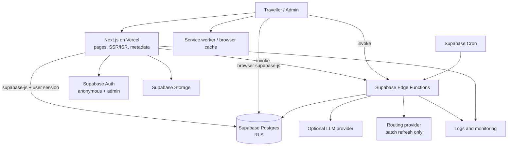
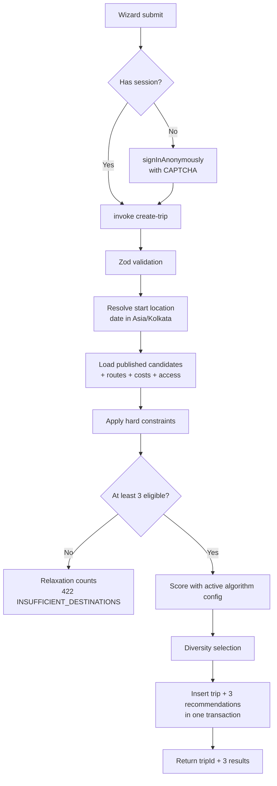

# Trip Roulette Kerala — Architecture & Technical Design

**Document version:** 1.2
**Date:** 4 November 2026
**Status:** Baseline for development. Stack confirmed; provider choices still open (§17).

**Changes in 1.2**

- Stack: **Next.js (App Router) on Vercel** for the web app; **Supabase** for Auth (Anonymous Auth for guests), Postgres with **RLS**, SQL migrations, Storage and **Edge Functions** for business logic. **No Prisma.**
- Guests get a Supabase anonymous identity; ownership is enforced by RLS on `auth.uid()`.
- Business logic lives only in Edge Functions; Next.js renders pages and holds no business rules.
- **Stale or missing essential access information now excludes a destination** (§5.2).
- Ranking weights and travel-time limits moved into configuration tables.

**Changes in 1.1** (kept): one trip = one recommendation set; precomputed route table; cost-assumption table; trip-scoped destination view; budget rule; frozen share snapshots; rule-based itinerary.

---

## 1. Architecture goals

- Keep the first release small and maintainable: one Next.js app, one Supabase project per environment.
- Make recommendation decisions deterministic, explainable and testable.
- Enforce data access in the database (RLS), and keep all authoritative business logic in one server-side place (Edge Functions).
- Make external services (routing, weather, AI, monitoring) replaceable.
- Support guest discovery, safe trip sharing, link previews and indexable destination pages.
- Avoid an LLM dependency for core product correctness.

## 2. Technology stack

| Layer | Technology | Responsibility |
|---|---|---|
| Web app | Next.js (App Router), React 19, TypeScript | Pages, server rendering, metadata |
| Hosting | Vercel (functions region `bom1`) | Builds, preview deployments, CDN |
| Styling | Tailwind CSS (tokens from the design handoff) | Design implementation |
| Validation | Zod (schemas shared by the app and Edge Functions) | Wizard and request validation |
| Client data | `@supabase/supabase-js`, `@supabase/ssr`, TanStack Query where client caching helps | Reads under RLS, function calls |
| Animation | Motion | Roulette and transitions |
| PWA | Web manifest + service worker (e.g. Serwist) | Installability, offline saved trips |
| Auth | Supabase Auth: **Anonymous Auth** for guests, email sign-in for admins | Identity for RLS |
| Database | Supabase PostgreSQL (`ap-south-1`, Mumbai) with RLS | Data and access control |
| Schema changes | SQL migrations (Supabase CLI) | Versioned schema, policies, functions |
| Business logic | Supabase Edge Functions (Deno, TypeScript) | Recommendations, spin, itinerary, sharing, events |
| Media | Supabase Storage + `next/image` | Destination images |
| Scheduled jobs | Supabase Cron (`pg_cron`) invoking Edge Functions | Cleanup, review-due flags, route refresh |
| Maps and routing | OpenStreetMap ecosystem + selected routing provider | Map links, precomputed route estimates |
| AI (optional, post-MVP) | LLM provider called from an Edge Function | Grounded explanations and wording |
| Monitoring | Error and performance monitoring service | Production diagnostics |

**Why Next.js:** destination discovery, search indexing and shareable trip pages are core features. Server-rendered pages give public destination pages and shared trips real HTML with Open Graph tags, so WhatsApp and other apps show preview cards.

**Why no Prisma:** the app talks to Supabase through `supabase-js` with the user's own session, so RLS is enforced on every query. Prisma would connect with a privileged role and bypass RLS.

## 3. Responsibilities: who does what

| Concern | Where it lives | Notes |
|---|---|---|
| Public catalogue reads (destinations, attractions, images, categories, locations) | Postgres via RLS (`anon` and `authenticated` can read published rows) | Read directly by Next.js server components and the browser |
| Reading your own trips, recommendations, spin result, itinerary, share links | Postgres via RLS (`owner_user_id = auth.uid()`) | Read directly; no function needed |
| Creating trips and recommendations | Edge Function `create-trip` | Writes with the service role after validating the caller |
| Spinning | Edge Function `spin` | Only place a winner can be written |
| Itinerary generation | Edge Function `generate-itinerary` (also called by `spin`) | |
| Share links (create, revoke, read) | Edge Functions `create-share-link`, `revoke-share-link`, `get-shared-trip` | Token hashing and snapshots in one place |
| Analytics events | Edge Function `track-event` | Allow-listed events and keys |
| Admin catalogue edits | Postgres via RLS (admin policies) + audit triggers; publish through RPC `publish_destination` | Publish checks live in SQL |
| Page rendering, metadata, ISR revalidation | Next.js | No business rules |

**Rule:** a business rule exists in exactly one place: an Edge Function or a Postgres function. Next.js route handlers are limited to `/api/revalidate` (called after publishing) and, if needed, Open Graph image generation.

## 4. High-level architecture



- Route estimates are **precomputed** for every supported starting town and destination pair and stored in Postgres. The routing provider is called only by the refresh job and admins.
- Core browsing and rule-based recommendations keep working if the LLM or weather provider is down. Provider failures produce explicit "unavailable" states, never invented values.
- Edge Functions should run close to the database: invoke them with the `ap-south-1` region option (confirm the current Supabase mechanism during setup).

## 5. Recommendation engine (`create-trip`)

### 5.1 Processing pipeline



Recommendations are computed **once**, when the trip is created, and stored. The recommendations page reads them through RLS and never recomputes. Changing preferences creates a new trip.

### 5.2 Hard constraints and data policy

A destination is eligible only if all of these hold:

1. It is `published`.
2. A route estimate exists from the start location for the chosen transport mode, and the one-way travel time is within the limit for the chosen duration (`duration_rules`).
3. The chosen duration is in the destination's `suitable_durations`.
4. It has at least one category matching the selected moods.
5. **Budget rule (strict, inclusive):** estimated cost per person ≤ budget. When the estimate is a range, the **upper bound** must fit.
6. **Essential access information is present, current and not closed** (table below).
7. The transport mode is not excluded by a current access record.
8. Required accessibility needs are supported by verified data.

**Data policy:**

| Situation | Effect |
|---|---|
| No route estimate for the start town and mode | **Excluded** |
| An essential cost item missing (entry fee, fuel inputs) | **Excluded** |
| No essential access record covering the travel date | **Excluded** (unverifiable) |
| Essential access record past its `review_due_at` | **Excluded** (stale) |
| Essential access record with status `closed` covering the date | **Excluded** |
| Essential access record with status `restricted` | Eligible with a warning that names the restriction |
| Non-essential access record stale or missing | Eligible with a warning ("Access check due — last verified …") |
| Destination requires a permit with unknown availability | Eligible with a warning; never claim availability |

"Essential" access information is whatever determines whether a visitor can get in on the day: general opening status, seasonal closures, permit requirements, entry restrictions. Road advisories, weather notes and facility details are non-essential. Admins set `is_essential` per record.

There is no per-destination override. Any future exception must be a date-specific verification recorded as a new essential access record, not a checkbox.

**Flexible dates:** essential access must be current and not closed for the next 14 days from today (Asia/Kolkata). This window is a configurable assumption.

**Browse pages** (homepage, Explore, public destination page) may still show a destination with stale essential access, labelled "Access check due — check the official source". Such a destination cannot be recommended.

### 5.3 Ranking (configurable)

Weights, curves and travel-time limits are **configurable product assumptions**, stored in `algorithm_configs` and `duration_rules`. Every recommendation records the `algorithm_version` and its score components, so changes can be compared after testing with real Kerala destinations.

Initial configuration (`1.0.0`):

| Feature | Weight | Score (0–1) |
|---|---:|---|
| Mood match | 30% | Matched selected moods ÷ selected moods (primary category 1.0, others 0.7) |
| Budget fit | 25% | 1.0 when cost ≤ 70% of budget, falling linearly to 0.5 at 100% |
| Travel-time fit | 20% | 1.0 when one-way time ≤ half the duration limit, falling linearly to 0.3 at the limit |
| Group suitability | 15% | 1.0 suitable, 0.5 unknown (unsuitable is filtered out) |
| Season fit | 10% | 1.0 in `best_season_months`, 0.5 unknown, 0.2 off-season |

Initial travel-time limits (`duration_rules`, one way):

| Trip duration | Max one-way travel |
|---|---|
| A few hours | 90 minutes |
| One day | 4 hours |
| Two days | 6 hours |
| Three to five days | 9 hours |

These are starting values to validate in beta, not permanent rules.

### 5.4 Diversity

- Pick the top-scoring candidate first.
- For each further pick, prefer a candidate whose primary category differs from those already picked, and which is more than 15 km (configurable) from a picked destination.
- Allow a repeat only when no eligible candidate meets the rule.
- Eligibility always beats diversity. If variety is limited, return the best eligible results with `limitedVariety: true`.

### 5.5 Fewer than three eligible

Return `422 INSUFFICIENT_DESTINATIONS` with the eligible count and up to three suggested adjustments. For each suggestion, re-run the filter with one constraint relaxed and report how many more places would qualify ("Raise budget to ₹1,000 · +2 places"). Candidates: next duration up, budget raised to the next preset, the extra mood that adds the most places, another transport mode. Never relax the essential-access rule. The app never applies a suggestion automatically. No trip row is created; the attempt is logged as an analytics event.

### 5.6 AI boundary

MVP uses deterministic templates only. When AI is added, the LLM may write explanations and polish itinerary wording from supplied structured facts. It must not invent destinations or attractions, create opening hours, fees, permits or closures, decide eligibility, scores or the winner, override budgets, or turn unknown data into confident statements. Validate LLM output against a schema and keep the template fallback.

## 6. Roulette service (`spin`)

1. Client invokes `spin` with `{ tripId }` and an `Idempotency-Key` header (a UUID created once per spin attempt and kept in sessionStorage). The user's JWT is sent automatically.
2. The function creates a user-scoped client from the caller's JWT and reads the trip. Under RLS this succeeds only for the owner; otherwise `404 TRIP_NOT_FOUND`.
3. It loads the three recommendations and re-checks each destination is still published. If not, `409 TRIP_STALE`.
4. If a result exists for the trip, return it (`200`), whatever key was sent.
5. Otherwise pick an index uniformly in {0, 1, 2} using `crypto.getRandomValues` with rejection sampling (discard values ≥ the largest multiple of 3 below 2³²), or `randomInt` from `node:crypto`.
6. Using the service-role client, insert into `roulette_results` with `ON CONFLICT (trip_id) DO NOTHING`, then read back the stored row. This guarantees one winner under concurrent requests.
7. Generate the default itinerary (§8) and store it.
8. Return the stored result, including its public code (e.g. `TR-8K2Q`).
9. The client animates to the returned index. On reload or timeout, the client reads `roulette_results` for the trip directly through RLS.

Clients have **no insert or update rights** on `roulette_results`, so a winner can only come from this function. Each destination has probability exactly one-third.

## 7. Cost estimation service

Shared module used by `create-trip`. Costs are computed per trip because fuel, parking and accommodation depend on route, group size and mode.

| Item | Formula | Inputs |
|---|---|---|
| Fuel | round-trip km × fuel price ÷ vehicle mileage × vehicles ÷ travellers | `location_destination_routes`, `cost_assumptions` |
| Vehicles | ceil(travellers ÷ seats per vehicle) | `cost_assumptions` (e.g. car 4, bike 2) |
| Parking / toll | per-vehicle cost × vehicles ÷ travellers | `destination_costs` (`per_vehicle`, by mode) |
| Entry fees | sum of per-person fees for planned attractions | `attractions.entry_fee_minor` |
| Food | per-person estimate by duration | `destination_costs` (`per_person`) |
| Accommodation | room cost × nights × rooms ÷ travellers | `destination_costs` (`per_room_night`) |
| Public transport | route fare where a reliable source exists | `destination_costs` (`per_person`, mode `public_transport`) |

Integer paise throughout; round the displayed per-person total up to the nearest ₹10. Output: per-person total (value or range), group total, itemised lines, included and excluded items, assumptions, completeness flag, oldest `verified_at`. Never show a single precise number when an essential input is unknown. The result is stored in `trip_recommendations.cost_snapshot`.

## 8. Itinerary service (`generate-itinerary`)

Deterministic in MVP. All inputs come from stored data (trip, spin result, attractions, access windows, route snapshot). The client may send only an optional departure time.

1. Drop attractions that are inactive or closed on the date.
2. Order by a simple nearest-next route from arrival.
3. Add activity durations and 15-minute buffers.
4. Add a lunch break between 12:30 and 14:00, and a rest stop on drives over 2.5 hours.
5. Check the plan fits the duration (including the drive home for day trips); drop the lowest-priority stop until it fits.
6. Store items with `day` and local times (Asia/Kolkata), plus warnings ("Opening hours not verified").

Label the result as suggested. Never imply a reservation or confirmed access.

## 9. Data model overview

Full definitions in `4. DATABASE_API_SPEC.md`.

- **Catalogue:** `districts`, `locations`, `categories` (= moods), `destinations`, `destination_categories`, `attractions`, `destination_costs`, `destination_images`, `access_information`, `information_sources`, `location_destination_routes`.
- **Configuration:** `algorithm_configs`, `duration_rules`, `cost_assumptions`.
- **Trips:** `trips`, `trip_recommendations`, `roulette_results`, `trip_itinerary_items`, `trip_share_links`.
- **Operations:** `admin_users`, `admin_audit_log`, `analytics_events`, `rate_limit_counters`.

Rules: UUID primary keys; foreign keys, check constraints and indexes on filtered fields; money as `bigint` paise with explicit currency; timestamps `timestamptz` in UTC; calendar dates in Asia/Kolkata.

## 10. Interfaces

Full contracts in `4. DATABASE_API_SPEC.md`.

**Edge Functions** (`/functions/v1/<name>`; all require a Supabase JWT, anonymous or admin, except where noted):

| Function | Purpose |
|---|---|
| `create-trip` | Validate, filter, score, store; return 3 or 422 |
| `spin` | Secure, idempotent selection; generates the default itinerary |
| `generate-itinerary` | Regenerate with an optional departure time |
| `create-share-link` | Frozen snapshot + token |
| `revoke-share-link` | Revoke a link you own |
| `get-shared-trip` | Public snapshot by token (callable with the anon key) |
| `track-event` | Allow-listed analytics events |
| `refresh-routes`, `daily-maintenance` | Scheduled; service role only |

**Direct reads under RLS** (supabase-js): locations search, catalogue, own trips, recommendations, spin result, itinerary items, own share links.

**Postgres functions (RPC):** `publish_destination(id)` (admin), `is_admin()` (policy helper).

**Next.js route handlers:** `/api/revalidate` (secret-protected, called after publish/archive) and optional OG image routes.

## 11. Security architecture

### 11.1 RLS model

- RLS is enabled on **every** table.
- Catalogue tables: `select` for `anon` and `authenticated` where the row (and its destination) is published; admins can read and write all rows.
- Trip tables: `select` where `owner_user_id = auth.uid()` (directly or through the parent trip). **No insert, update or delete policies for clients**; writes happen only in Edge Functions using the service role after checking the caller.
- Configuration tables: readable by admins; writable by `admin` role only.
- `analytics_events`, `rate_limit_counters`, `admin_audit_log`: no client access; written by functions and triggers.
- Policies are tested with automated database tests (pgTAP or equivalent) for `anon`, anonymous `authenticated`, another user, `editor` and `admin`.

### 11.2 Guest identity (Anonymous Auth)

- The app calls `supabase.auth.signInAnonymously()` when a guest first submits the wizard (not on page load, to avoid creating users for every visitor).
- Protect anonymous sign-in with CAPTCHA (e.g. Cloudflare Turnstile) and Supabase's auth rate limits.
- Sessions are stored in cookies through `@supabase/ssr`, so Next.js server components see the same user.
- Anonymous users can later be converted to permanent accounts by linking an identity; `auth.uid()` and trip ownership stay the same.
- Policies that grant admin rights must also require a non-anonymous user (`is_anonymous` claim false).
- Anonymous users and their trips are deleted after the retention period by the daily maintenance job.

### 11.3 Admins

- Admins sign in with email through Supabase Auth.
- `admin_users` holds roles (`editor`, `admin`); `is_admin()` is a `security definer` helper used in policies.
- Next.js middleware protects `/admin` pages for usability; RLS is the real enforcement.
- Audit triggers write every catalogue and configuration change to `admin_audit_log`.

### 11.4 General

- The service-role key exists only in Edge Function secrets, never in Vercel or the browser. Vercel holds only the public URL, anon key and the revalidation secret.
- Never trust client-supplied user IDs, scores, winners or prices.
- Rate-limit `create-trip`, `spin`, `generate-itinerary`, `create-share-link` and `track-event` per user and per IP, using `rate_limit_counters` in Postgres.
- Share tokens: 128+ bits of randomness, stored as SHA-256 hashes, revocable, always expiring. Send `Referrer-Policy: no-referrer` on shared pages.
- No precise geolocation is stored; geolocation only suggests the nearest supported town.
- Storage buckets: public read for published images only; uploads by admins; type and size validated.
- CSP and security headers in `next.config`; CORS on Edge Functions limited to the app's domains; dependency review before launch.

## 12. Rendering, PWA and caching

| Page | Rendering |
|---|---|
| Homepage, Explore, public destination pages | Static with revalidation (ISR) using the anon key; revalidated by `/api/revalidate` on publish/archive |
| Shared trip `/shared/[token]` | Server-rendered per request via `get-shared-trip`; Open Graph tags; `Cache-Control: private, no-store` |
| Wizard, recommendations, roulette, trip destination view | Server shell + client components reading under the user's session; not cached by the CDN |
| Admin | Server-rendered, never cached |

Service worker caches versioned static assets, public destination pages and images (with a freshness label), and the user's saved-trip list and last-viewed trips so they open offline. It does not cache admin data, auth responses, or anything in shared caches. Offline pages say route, weather, access and price information may be out of date. Spinning requires a connection.

## 13. Observability

Capture: request ID and function name, latency and status, validation failure category, candidate count, exclusion reasons (including stale essential access), insufficient-results reason, provider availability and timeouts, spin idempotency outcome (new / replayed / concurrent), errors and release (Vercel deployment ID, function version).

Do not log precise location, JWTs, share tokens or free text.

## 14. Code sharing

Zod schemas, types, enums and the cost/eligibility helpers live in `supabase/functions/_shared/`. A Deno import map (`deno.json`) maps bare imports such as `zod` to `npm:` specifiers, so the same files can be imported by Next.js (through a TypeScript path alias) for client-side validation. Business rules execute only in Edge Functions; the app imports schemas and types, not rules.

## 15. Environments and delivery

| Environment | Vercel | Supabase |
|---|---|---|
| Local | `next dev` | Supabase CLI local stack (`supabase start`) |
| Preview | Preview deployment per branch | Shared **staging** project (sample data, clearly marked) |
| Production | Production deployment | Production project (editorially verified content) |

- Schema, policies and SQL functions change only through migrations in `supabase/migrations/`, applied by CI (`supabase db push`) before functions and app deploy.
- Edge Functions deploy from CI (`supabase functions deploy`).
- Seed non-production with 10–15 sample destinations across several moods and districts, routes from 3–4 starting towns, and cost assumptions, all marked as sample data.
- Enable point-in-time recovery on production before public launch.

Repository layout:

```text
trip-roulette/
├── src/
│   ├── app/              # Next.js routes and pages
│   ├── components/
│   └── lib/
│       └── supabase/     # browser and server clients (@supabase/ssr)
├── supabase/
│   ├── migrations/       # schema, RLS policies, SQL functions, triggers
│   ├── functions/
│   │   ├── _shared/      # Zod schemas, types, engine, costs, itinerary
│   │   ├── create-trip/
│   │   ├── spin/
│   │   ├── generate-itinerary/
│   │   ├── create-share-link/
│   │   ├── revoke-share-link/
│   │   ├── get-shared-trip/
│   │   ├── track-event/
│   │   ├── refresh-routes/
│   │   └── daily-maintenance/
│   ├── tests/            # pgTAP policy tests
│   └── seed.sql
├── public/               # manifest, icons
├── tests/                # Vitest, Playwright
├── docs/
└── README.md
```

## 16. Scheduled jobs (Supabase Cron)

| Job | Frequency | Purpose |
|---|---|---|
| `daily-maintenance` | Daily | Delete expired anonymous users, trips and share links; flag review-due records for editors |
| `refresh-routes` | Weekly or on demand | Recompute `location_destination_routes` |

## 17. Decisions still open

- Routing provider (Kerala road coverage, quota, terms) and refresh cadence.
- Weather provider; weather is advisory only unless decided otherwise.
- Image sourcing, licence and attribution workflow.
- Retention periods for anonymous users, trips, share links and events (90 / 90 / 30 / 365 days assumed).
- Analytics and monitoring providers.
- Cost data sources and review cadence.
- Whether a user may pick one of the other two matches instead of the wheel's choice.

## 18. Architecture decision records

Record ADRs for: stack (Next.js + Supabase, no Prisma), RLS and write-through-functions model, Anonymous Auth, essential-access exclusion policy, configurable ranking, rate limiting. Each ADR records context, options, decision, consequences, date, owner and revisit conditions.

Do not change recommendation behaviour, budget methodology, data visibility or access policy without reviewing downstream effects and tests.
